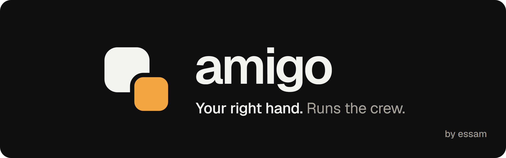

# amigo

Your right hand. Runs the crew. You are the Boss: you talk to one agent, **amigo**, your foreman, about any software work across your projects. amigo does not do the work itself. It writes instructions and hands each piece to a **crew member** (another agent in its own herdr-app tab, with its own git worktree for code), runs them in parallel, watches them, and brings you outcomes: the pull request with its full link, the finished report, or the one decision only you can make.

Each task is a **build** (it changes a project) or a **survey** (it produces a written report). Each project has a delivery mode: the crew member runs the [no-mistakes](https://github.com/kunchenguid/no-mistakes) pipeline to a pull request, opens the pull request itself, or leaves a clean ready branch. amigo merges only green work, and only on your word or when you made the project yolo.

amigo itself runs on Claude Code inside the herdr desktop app; crew members can run on any supported agent CLI. It is a small Node.js tool with no runtime dependencies and works natively on Windows, Linux and macOS.

Made by [essam](https://essam.pro). Workflow ported from firstmate by Kun Chen (MIT).

```
Boss ──▶ amigo ──spawn──▶ crew member 1 (build: worktree, branch fix/<title>, PR)
           ▲              crew member 2 (survey: data/<id>/report.md)
           │              crew member 3 (queued until capacity frees up)
           └── "Boss, the footer fix is green: https://github.com/me/my-app/pull/12. Merge it?"
```

## Install

You need Node.js 24.3 or newer, git, Claude Code, and the herdr desktop app (`herdr-app`, with `herdr-app` and `hc` on PATH). amigo runs only inside a herdr-app terminal and refuses to start anywhere else. It was tested with herdr-app 0.1.16 and hc 0.1.21; the session-start digest warns when another version is installed. Builds use [treehouse](https://github.com/kunchenguid/treehouse) for worktrees, `gh` for GitHub, no-mistakes for `no-mistakes` projects (its `init` also adds a no-mistakes skill to `~/.claude/skills` and `~/.agents/skills`; amigo asks you once whether to keep it and otherwise has it removed after init), and [tasks-axi](https://github.com/kunchenguid/tasks-axi) (0.2.6 or newer) for the backlog.

```sh
git clone https://github.com/mohamedessambarakat/amigo
cd amigo
npm install -g .
amigo install-skill
```

- `npm install -g .` links the `amigo` command to this folder, so keep the folder where it is (`git pull` or `/updateamigo` updates it). Installing straight from GitHub (`npm install -g github:...`) does not work: Node will not run TypeScript from inside `node_modules`.
- `amigo install-skill` adds every supported agent CLI it finds to your config. amigo itself runs only on Claude Code (its Stop hook runs the watcher and the turn-end guard), so only Claude Code gets `/amigo`, which reloads amigo's instructions inside a session the `amigo` command started; the other agents run crew members. For Claude Code it also installs your commands inside an amigo session: `/catchup`, `/rundown`, `/remember`, `/updateamigo`, `/afk` and `/quiet`. It prints every file it writes, never overwrites a file it did not write, and `amigo install-skill --remove` takes them out again.
- Everything amigo stores lives in `~/.amigo/` (`AMIGO_HOME` puts it elsewhere): `config/` (local choices), `data/` (durable records: the project registry, `boss.md`, `learnings.md`, the backlog, briefs and survey reports), `state/` (runtime records, status events, the wake queue, the worktree pool) and `projects/` (amigo's own clones).
- **Coming from an older amigo?** A home with `config.json` and `projects.json` at its top is refused until you convert it: close every open task, run `amigo migrate --dry-run` to see the plan, then `amigo migrate`. Each registered folder becomes a clone in `~/.amigo/projects/<name>` (registered `no-mistakes` with yolo on; a folder without an origin becomes `local-only`). `--live <project>` records the old folder as its live install, `--drop <project>` leaves one out. The old gate files are dropped; task history moves to `state/tasks/`.

## Add your projects

```sh
amigo add https://github.com/me/my-app.git
amigo add git@github.com:me/website.git --name site --mode direct-PR --yolo --notes "Never touch .env."
```

`add` clones the project into `~/.amigo/projects/<name>` and registers your standing posture for it: `--mode no-mistakes` (the default), `direct-PR` or `local-only`; `--yolo` (amigo may merge green work itself; off by default); and `--live <folder>`, a folder you run the project from, fast-forwarded after every confirmed merge. Running `add` again with the same name and source updates the entry. Notes are hard rules for every crew member on that project (`amigo note my-app "Use the v2 endpoint."`).

amigo never writes to a clone except through `amigo sync` (a fast-forward from origin when that is safe; anything else is reported and left alone), the guarded local-only landing and the refresh after a merge. Each crew member gets a worktree leased from treehouse's pool, checked to be separate from the clone, reset to origin's current default branch, with a new branch. To keep amigo itself up to date with `/updateamigo`, register this folder as the live folder of a project named `amigo`.

## Start working

In a herdr-app terminal, run `amigo`. It starts Claude Code with amigo's hooks; an ordinary Claude Code session has none of them, so `/amigo` there refuses and tells you to start with `amigo`. The session-start digest runs once (and again after a compaction): it takes the session lock (a second session is read-only and says why), checks your tools, presents queued notifications, shows every open task and reconciles anything that stopped while you were gone. Then you just talk:

```
> fix the broken footer link in my-app, and look into why the site build got slow
```

amigo picks the project, writes the instructions (your own words under `## Boss's intent`, its build instructions under `## amigo spec`) and starts a crew member per task. You hear from it when something needs you or is done, in plain outcomes; it says "All good, Boss." only when there is truly nothing to report. Your commands inside the session:

- `/catchup` recaps what happened since your last message and walks you through open decisions one at a time.
- `/rundown` gives a fresh four-part snapshot: Boss's Call, Recently Landed, Underway, Next Up (`/rundown file` also saves it).
- `/remember` saves what amigo learned this session into `data/boss.md` and `data/learnings.md`, files unfiled open work, and keeps that memory small.
- `/afk [instructions]` tells amigo you are away: it records your words verbatim, acts on them under its standing authority, and holds anything that needs you for your return. Your next ordinary message is the return, with a brief of what happened.
- `/quiet` keeps you in the session with fewer routine updates; `/quiet off` ends it.
- `/updateamigo` fast-forwards amigo's own folder from origin and picks up the new instructions.

## How it works

**The contract.** amigo's instructions are `prompts/amigo.md`: a short always-loaded contract (identity and hard rules, intake, delivery and merge authority, supervision, how to talk to you) plus agent-only playbooks in `skills/agent/` that it reads only at their trigger (stuck crew recovery, landing, survey completion, validation, ask-user findings, diagnosis, decisions, projects, away mode). Crew members get `prompts/member.md` and, for a build, a brief generated from code. Inside an amigo session the contract wins over your other standing instructions, except your security rules.

**Builds and delivery.** A build's brief (`data/<id>/brief.md`) is your intent and amigo's spec, wrapped by code in an isolation check, the rules, the status protocol, the steering inbox and the definition of done of the project's mode, which opens with a fixed `Delivery contract: mode=<mode>` line; spawn refuses a brief whose mode disagrees with the registry. `no-mistakes`: the crew member commits, reports a first done (the handoff), then on `amigo send <id> --validate` runs the pipeline, which pushes and opens the pull request, and reports `done: PR <url> checks green`. `direct-PR`: it pushes and opens a ready pull request and reports `done: PR <url>`. `local-only`: it commits on its branch and reports `done: ready in branch <branch>`. A done line is gated in code: a pull request line counts only when the head is pushed and the worktree is clean, a local-only line only when the head is the branch itself.

**Surveys.** `spawn --survey` writes `~/.amigo/data/<id>/report.md` and never pushes (every push from its session is refused). Its worktree is a laboratory, thrown away at cleanup. `close` refuses a survey until its report exists and its open questions for you are held in the backlog and attested (`amigo complete`).

**Status and steering.** A crew member reports with `amigo report <state> "<one line>"` (working, needs-decision, blocked, paused, done, failed, resolved, note), and ends each turn with a matching `STATUS:` line. `amigo send <id>` writes a durable message to its inbox and rings its tab (a crew member still starting is rung in the background once its agent is up, waiting up to 60s); it acknowledges by moving the message to `handled/`. Lifecycle is separate: `amigo control <id> interrupt|exit|relaunch`.

**Supervision.** A zero-token watcher, armed by amigo's Stop hook at every turn end while work is open, sleeps on the fleet and wakes amigo only for something actionable: a status event, a crew member that stopped responding, a registered check, a pull request whose CI turned red or green or that was merged or closed on GitHub, or a periodic heartbeat. Wakes go through a durable queue that amigo drains and acknowledges, so a restart never loses one. The turn-end guard stops a turn from ending blind while work is under way.

**Merge and after.** `amigo merge <id>` reads the pull request live and merges only when it is open, not a draft, mergeable and green on every required check at its current head, with that head pinned (`gh pr merge --match-head-commit`), and counts it only once GitHub reads back merged. A local-only build lands by a guarded fast-forward. amigo never merges or lands work that adds or changes a secret-looking file (`.env`, `.env.local`, `.envrc` but not `.env.example`, private keys, certificates, `credentials.json`, `.netrc`) in its final files or any of its commits, not even with `--boss`; remove the file (and rotate the secret if it was real), or merge by hand on GitHub. Without `--boss` (you said "merge it") only a yolo project's work is merged, and a red or missing check is waived only on your explicit word; while you are away, waivers and local-only landings wait for your return. After a merge amigo refreshes the clone, fast-forwards the `--live` folder (skipped and reported when it is dirty or diverged) and cleans up only after the landed-work test. `close` applies the same test; `--force` discards work only on your explicit word.

**Backlog, dispatch and capacity.** Once `~/.amigo/data/backlog.md` exists, tasks-axi keeps the work queue: spawn and close move items, and a decision is an item held for you (`amigo hold`, `--until <date>` when you say "later"; `amigo answer` records your exact words). An optional `config/crew-dispatch.json` maps kinds of work to agent, model and effort profiles in declared order (`amigo dispatch`). `config/lane-capacity` and `config/project-capacity` cap how many crew members run at once; a spawn beyond them stays queued and starts by itself.

You can use every command yourself too:

```
amigo: your right hand. Runs the crew.

  amigo [--agent <name>] [--dry-run]                start amigo in this terminal: a briefing first, then you just talk to it
  amigo install-skill [<agent>] [--remove]          set up your agent CLIs: /amigo for Claude Code, crew templates for the rest
  amigo brief --agent <name>                        print amigo's instructions and the briefing (what /amigo runs; only inside a session amigo started)
  amigo add <git url or path> [--name <name>] [--mode no-mistakes|direct-PR|local-only] [--yolo | --no-yolo]
            [--live <folder>] [--notes <text>] [--live-command <cmd>]... [--watch <text>]...
                                                    clone a project into projects/<name> and register it; the same name and source again updates it
  amigo projects                                    list registered projects
  amigo sync [<project>]                            refresh the clones from origin (fast-forward only; anything unsafe is reported, never touched)
  amigo migrate [--live <project>]... [--drop <project>]... [--dry-run]
                                                    convert a home from before this version: projects become clones, the old gate files go
  amigo note <project> <text>                       add a line to a project's notes (every later crew member gets it)
  amigo spawn (--project <name> | --review <id> | --scratch) [--type <t>] [--title <t>] [--agent <name>] [--after <id>] [--issue <n>] [--brief-file <file>] [--dry-run]
                                                    start a crew member; the brief comes from stdin unless --brief-file is given. A build's
                                                    brief is "## Boss's intent" and "## amigo spec"; amigo adds the rules and the definition of done.
                                                    A build needs --type feat|fix|refactor|docs|style|test|chore|perf|build|ci: its
                                                    branch is <type>/<title words>, as fix/sidebar-alignment
            [--survey] [--task <backlog id>] [--model <m>] [--effort low|medium|high|xhigh|max] [--boss-max]
                                                    a survey writes data/<id>/report.md and never pushes; --task dispatches a backlog item
  amigo status [<id>]                               tasks by station, or one in detail (status, inbox, PR, uncommitted files)
  amigo inbox                                       crew members that finished since you last looked, and background results
  amigo wait [<id>...] [--timeout-min <n>]          wait until a crew member finishes a turn (default 60 min)
  amigo send <id> [--resolve-key <key>]... [--validate | --file <file> | <message>]
                                                    steer a crew member: the message goes to its durable inbox and its tab is rung
                                                    (--validate: tell a no-mistakes build to run its pipeline; --resolve-key closes that open decision)
  amigo control <id> interrupt|exit|relaunch [--note <text>]
                                                    lifecycle: stop its turn, stop its agent (worktree kept), or start it again with a note
  amigo report <state> [--key <key>] <text>         (crew members) append a status line: working, needs-decision, blocked, paused, done, failed, resolved, note
  amigo attach <id>                                 print a crew member's results and follow it while it runs
  amigo pr-check <id> [<pr url>] [--watch [--timeout-min <n>]]
                                                    read a build's PR live (CI, merge state); a merge on GitHub is recorded and cleaned up after
  amigo merge <id> [--boss] [--pr <url>] [--expected-head <sha>] [--allow-red <check>] [--allow-missing <check>] [--method squash|merge|rebase]
                                                    land a build: a PR only when open, not a draft, mergeable and green at its pinned head;
                                                    local-only by a guarded fast-forward. Without --boss (the Boss said "merge it") only a yolo project
  amigo land <id>                                   finish after a merge: refresh the clone, fast-forward the live folder, clean up once landed
  amigo close <id> [--force]                        tear a crew member down; a build only once its work has landed (--force: the Boss said discard it)
  amigo digest [--again]                            the session-start digest: take the session lock, drain wakes, show the fleet (once per session)
  amigo rotate                                      (amigo itself) restart amigo's session fresh at this turn end, to free context
  amigo wake (drain | ack --through <seq> --generation <n> | status)
                                                    the durable wake queue: show it, acknowledge what was handled, or count it
  amigo watch                                       run one watcher cycle here and print the wake it closes on (the Stop hook does this itself)
  amigo daemon                                      read the shared no-mistakes daemon; on Windows start it only when it is positively down
  amigo check (add <name> [--every <s>] [--cwd <dir>] -- <command>... | rm <name> | list)
                                                    commands the watcher runs on an interval; anything they print wakes amigo
  amigo backlog [<tasks-axi command> [args...]]     the work queue (data/backlog.md) through tasks-axi: list, ready, add, show, update...
  amigo hold <id> --reason <text> [--until YYYY-MM-DD] [--title <t> [--project <p>]] [--origin <survey id>]
                                                    hold a backlog item for the Boss's call (--title creates it); --until defers it to a date
  amigo answer <id> [--release] (<the Boss's words> | --file <file>)
                                                    record the Boss's exact answer: closes the call, or --release lets the held work go on
  amigo complete <survey id> (--none | <held item id>...)
                                                    attest a survey's open Boss calls (or none), so close may tear it down
  amigo dispatch [<rule number> | default]          the dispatch profiles, or one rule resolved to spawn flags
  amigo capacity                                    lanes in use, open lanes and host headroom, and project caps
  amigo away (afk | quiet) [--words-file <file> | --words <text>] [--expected-return <time>] | away (return | status)
                                                    record the Boss's /afk or /quiet posture and his words verbatim; return archives it
  amigo update                                      fast-forward amigo's own code folder (a project's live folder) from origin
  amigo help                                        this text (-h or --help anywhere in a command prints it too)
  amigo --version                                   print the version

Data lives in $AMIGO_HOME (default ~/.amigo): config/, data/, state/ and projects/.
```

## Agents

`~/.amigo/config/config.json` holds one entry per agent. `amigo` starts the session you talk to, and only Claude Code has one: the Stop hook supervision and the user commands are Claude Code's, so `amigo` refuses another agent as the lead. `member` starts a crew member: Claude Code runs it as an interactive session; other agents run one task and exit, unless the agent sets `"interactive": true`. `{prompt}` is replaced by the instructions, and `{cwd}` by the crew member's folder with forward slashes. `install-skill` fills this in for you; edit it to change flags.

```json
{
  "agents": {
    "claude": {
      "amigo": ["claude", "{prompt}"],
      "member": ["claude", "--permission-mode", "auto", "{prompt}"]
    }
  },
  "memberMb": 600,
  "reserveMb": 2048,
  "rotateAtTokens": 500000
}
```

| Agent | Slash command | `amigo` | `member` |
|---|---|---|---|
| Claude Code | `/amigo` | `["claude", "{prompt}"]` | `["claude", "--permission-mode", "auto", "{prompt}"]` |
| Codex | none | none | `["codex", "exec", "--sandbox", "workspace-write", "--skip-git-repo-check", "{prompt}"]` |
| Gemini CLI | none | none | `["gemini", "--approval-mode", "auto_edit", "-p", "{prompt}"]` |
| Antigravity | none | none | `["agy", "-p", "{prompt}"]` |
| Grok | none | none | `["grok", "-p", "--always-approve", "{prompt}"]` |

Flags come from each tool's documentation; check them against your installed version.

- **Permissions are yours to choose.** Crew members work without anyone approving each step, so a crew member can only do what its flags allow, and whatever you allow applies to every crew member. Claude Code's `auto` mode lets a classifier approve safe actions and blocks risky ones; Codex works in a sandbox limited to the crew member's folder; Gemini CLI approves edits only; Grok's `--always-approve` approves everything your Grok deny rules allow; Antigravity's `--mode auto` approves edits and safe commands. Flags that skip all checks belong only inside a container or VM.
- Crew members use the same agent as amigo unless a dispatch profile or amigo picks another (`--agent`).
- A crew member starts only while free memory, minus `memberMb`, stays at or above `reserveMb`; other tasks wait in a queue. Only one crew member runs in a folder at a time.
- amigo's own session rotates once its context passes `rotateAtTokens` (default 500000; `0` turns it off): amigo saves what only that session knows with `/remember`, and the `amigo` command restarts it fresh in the same tab with the full digest.
- **Interactive crew members of other agents.** Set `"interactive": true` on an agent whose `member` template starts an interactive session, such as Antigravity's:

  ```json
  "member": ["agy", "--mode", "auto", "--settings", "{\"trustedWorkspaces\":[\"{cwd}\"]}", "-i", "{prompt}"],
  "interactive": true
  ```

  Its crew member then gets its tab's terminal, so you can watch it work and type into it, and its session stays open after each turn. It reports with `amigo report`, and `amigo send`, `amigo control` and `amigo close` work as for Claude Code; `output.log` keeps only its stderr. Nobody answers a dialog in an unattended tab, so the template must not stop to ask: here `--mode auto` approves edits and safe commands, and `--settings` trusts the crew member's folder for this session only, which skips Antigravity's folder-trust question without changing its saved settings. Without the field, the template runs one task and exits, and its output is kept in `output.log`.
- **Claude Code crew members** are interactive sessions named `amigo-<id>` that you can type into in their tab. Hooks record each turn's report, and a turn that ends without one is sent back once. Before one starts, amigo marks its folder trusted in `~/.claude.json` and removes that entry when the worktree is closed.
- On Windows, agents installed by npm are `.cmd` files that cannot carry a multi-line prompt, so they get one line: "Read the file <path> and follow the instructions in it exactly." The same happens for any prompt longer than 24,000 characters.

Check a template without running anything: `amigo spawn --project <name> --type docs --dry-run --brief-file README.md` prints the exact command.

## Install with an AI agent

Give your agent the link to this repository and ask it to set up amigo. Agent, do these steps in order:

1. Check `node --version` (24.3 or newer) and `git --version`. If one is missing, stop and tell the user.
2. Clone the repository into a folder the user will keep, and run `npm install -g .` inside it. Check: `amigo help` prints the command list.
3. Run `amigo install-skill <your agent>` (claude, codex, gemini, antigravity or grok). **Ask the user** whether the crew member permission flags are right for them; never switch to flags that skip all checks on your own.
4. **Ask the user** which projects to add, their delivery mode and whether any may be yolo, then run `amigo add <git url or path> [--mode ...] [--notes "..."]` for each. Check: `amigo projects` lists them.
5. Check the template: `amigo spawn --project <name> --type docs --dry-run --brief-file README.md` must print a command, not an error.
6. Tell the user to run `amigo` in a herdr-app terminal. Do not start it yourself.

## Safety

- amigo never edits a project itself: crew members change projects on their own branches, and amigo writes to a clone only through `sync`, the guarded local-only landing and the refresh after a merge.
- Merges happen only through `amigo merge`, only for green work, and only on your word or a yolo project. Away mode never widens that.
- Crew members cannot run amigo's managing commands (`spawn`, `send`, `control`, `merge`, `land`, `pr-check`, `close`, `add`, `note`, `install-skill`, `inbox`, `wait`, `brief`, `away`, `update` and the rest) or start a session.
- Crew members run code they wrote (tests, scripts, the no-mistakes pipeline) with your permissions, so a permission mode is not a sandbox. Run them only on projects whose code you would run yourself, or run amigo inside a container or VM.
- `close` refuses to throw away work that has not landed unless you add `--force`.

## Development

```sh
npm install
npm run typecheck
npm test
```

Tests run the real CLI against a fake agent (`test/fake-agent.mjs`), a fake GitHub CLI (`test/fake-gh.mjs`, found through `AMIGO_GH`, with a local bare repo as `origin`), a fake tasks-axi and a fake treehouse, in temporary folders, with crew member tabs replaced by detached processes (`AMIGO_TERMINAL=test`).

| Folder | What is in it |
|---|---|
| `src/` | The CLI: commands, agent launching, task state, delivery, merge, supervision, git worktrees, skill files |
| `prompts/` | The instructions given to amigo (`amigo.md`) and to every crew member (`member.md`) |
| `skills/` | amigo's agent-only playbooks (`agent/`) and the Boss's slash commands (`user/`) |
| `test/` | Unit tests, end-to-end tests and the fakes |
| `docs/` | Images for this README, plans (`docs/plans/`) and research (`docs/research/`) |

## License

MIT. Workflow ported from firstmate by Kun Chen (MIT); both notices are in [LICENSE](LICENSE).
